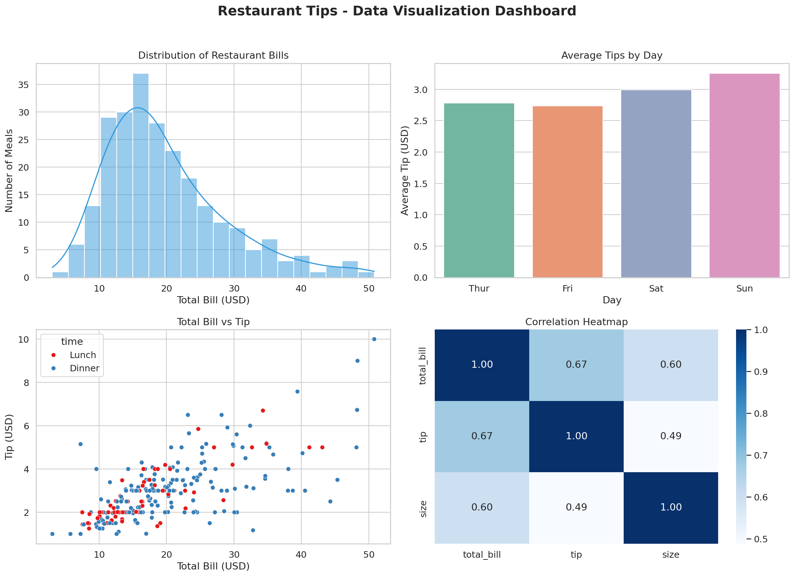

## Project Overview

This project focuses on exploring and visualizing real-world data using Python, Matplotlib, Seaborn, Pandas, and NumPy.

The project uses the Seaborn Tips dataset to create informative visualizations and identify meaningful patterns and relationships in restaurant billing and tipping behaviour.

The objective is to understand how to select appropriate charts, customize visualizations, analyze numerical relationships, and communicate data insights effectively.

## 🎯 Project Objectives

- Explore and analyze a real-world dataset.
- Create histograms and bar charts.
- Generate box plots and scatter plots.
- Calculate and visualize correlation matrices.
- Create customized color palettes and chart formatting.
- Build a combined visualization dashboard.
- Interpret charts and communicate findings through observations.

## 🛠️ Technologies Used

- Python
- Pandas
- NumPy
- Matplotlib
- Seaborn
- Google Colab

## 📁 Dataset

**Dataset:** Seaborn Tips Dataset

The dataset contains restaurant billing information, including:

| Column | Description |
|---|---|
| total_bill | Total restaurant bill |
| tip | Tip amount |
| sex | Customer gender category in the dataset |
| smoker | Whether the customer is classified as a smoker |
| day | Day of the week |
| time | Lunch or dinner |
| size | Number of people in the dining party |

## 📈 Visualizations Created

### 1. Histogram – Distribution of Restaurant Bills

Displays the distribution of total restaurant bills and helps identify common bill ranges.

### 2. Bar Chart – Average Tips by Day

Compares the average tip amounts across different days of the week.

### 3. Box Plot – Tip Distribution Across Days

Shows the median, spread, and potential outliers in tip amounts across different days.

### 4. Scatter Plot – Total Bill vs Tip

Explores the relationship between restaurant bills and tip amounts, with meal time represented using different colors.

### 5. Correlation Heatmap

Displays correlations between numerical variables to identify the strength and direction of linear relationships.

### 6. Custom Color Palette Visualization

Uses customized colors to display restaurant visits across different days.

### 7. Combined Visualization Dashboard

Combines four major visualizations into a single 2 × 2 dashboard.

## 📊 Dashboard Preview



## 🔍 Key Analysis

The project investigates the following questions:

1. How are restaurant bills distributed?
2. How do average tips vary across different days?
3. Is there a relationship between total bills and tips?
4. Which numerical variables have the strongest correlation?

The findings are generated programmatically from the dataset during project execution.

## 📂 Project Structure

```text
Data-Visualization-Matplotlib-Seaborn/
│
├── Project_02_Data_Visualization.ipynb
│
├── chart1_histogram.png
├── chart2_barplot.png
├── chart3_boxplot.png
├── chart4_scatterplot.png
├── chart5_heatmap.png
├── chart6_custom_palette.png
│
├── tips_dashboard.png
│
└── README.md
```

## 🚀 How to Run the Project

1. Clone this repository:

```bash
git clone https://github.com/YOUR_USERNAME/Data-Visualization-Matplotlib-Seaborn.git
```

2. Navigate to the project directory:

```bash
cd Data-Visualization-Matplotlib-Seaborn
```

3. Install the required libraries:

```bash
pip install pandas numpy matplotlib seaborn jupyter
```

4. Open the notebook using Jupyter:

```bash
jupyter notebook
```

5. Open `Project_02_Data_Visualization.ipynb` and run the cells.

Alternatively, upload the notebook directly to Google Colab.

## 📚 What I Learned

- Working with real-world datasets using Pandas.
- Exploring and cleaning data.
- Creating visualizations using Matplotlib and Seaborn.
- Selecting suitable charts for different analytical questions.
- Understanding correlation matrices and numerical relationships.
- Customizing chart colors, labels, titles, and formatting.
- Creating dashboards to communicate data insights.
- Writing meaningful observations from visual data.

## 👨‍💻 Author

**Joel V Koshy**

Data Science & AI | Python | Machine Learning | Data Analytics

## 📌 Project Information

- **Project:** Project 02
- **Domain:** Data Science & AI
- **Level:** Beginner
- **Estimated Duration:** 6 Hours
- **Organization:** InternCircle

---

⭐ If you find this project useful, feel free to explore the repository!

